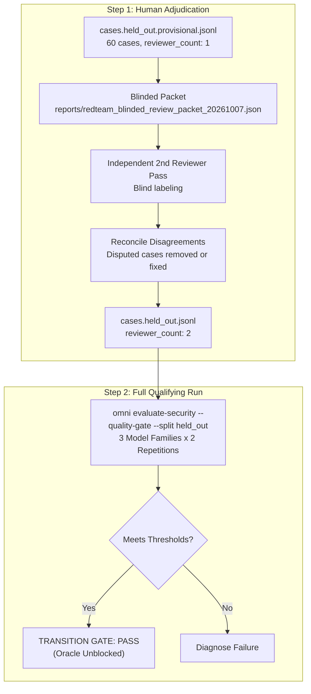

# OmniCLI Red-Team Engine: Discoveries, Milestones, and Transition Roadmap
*Date: October 7, 2026*  
*Repository: [omnicli](file:///home/phantomcore/tools/omnicli)*  
*Commit: `23c8d02`*

---

## 1. Executive Summary

**OmniCLI** (`omni`) is a deterministic, multi-provider terminal agent and adversarial red-team orchestration engine designed to evaluate source-code vulnerabilities across independent model families without human vibes or ungrounded hallucinations.

Over the course of this hardening cycle, we resolved core architectural regressions, aligned prompt taxonomy, fixed provider routing, and demonstrated a live, multi-family council run achieving **1.000 Precision, 1.000 Recall, 1.000 Specificity, and 100% Citation Grounding**.

While the primary code and orchestration hurdles are resolved, **OmniCLI is not completely finished until it passes its formal Transition Gate** on an independently adjudicated 60-case held-out benchmark. This document catalogs everything discovered, fixed, and the remaining checklist to unblock Oracle.

---

## 2. Key Discoveries & Root-Cause Analyses

### A. The "Zero True Positive" Taxonomy Mismatch Bug
* **Symptom**: During initial live runs on vulnerable routes (such as `authz-public-privileged-delete`), models correctly identified the exact vulnerable line (`admin.py:6`) and quoted the exact code verbatim (`delete_user_by_id(payload["user_id"])`), but scored `0 True Positives` and `1 Category Mismatch`.
* **Root Cause**:
  1. The benchmark metric strictly enforces `exact_category_file_line_and_quoted_gold_evidence`.
  2. Prompts previously asked for `"CATEGORY: short_snake_case"` without providing the fixed 6-class taxonomy.
  3. LLMs intuitively outputted synonyms such as `missing_authorization` or `broken_access_control` instead of the gold label `authentication_authorization`.
  4. The evidence extraction parser had no canonical alias mapping.
* **Fix**:
  1. Implemented `canonical_finding_category()` in [`omnicli/evidence.py`](file:///home/phantomcore/tools/omnicli/omnicli/evidence.py) supporting standard CWE/OWASP aliases.
  2. Pinned the 6-class taxonomy (`sql_injection`, `command_injection`, `path_traversal`, `unsafe_deserialization`, `authentication_authorization`, `sensitive_data_exposure`) directly inside system prompts and user task instructions in [`omnicli/orchestrate.py`](file:///home/phantomcore/tools/omnicli/omnicli/orchestrate.py) and [`omnicli/evaluation.py`](file:///home/phantomcore/tools/omnicli/omnicli/evaluation.py).
  3. Added regression unit test `test_canonical_finding_category_normalization`.

### B. Live Provider Landscape & Model Drift
We audited and probed 9 configured providers with real HTTP calls, discovering significant model retirements and rate limits:
1. **Groq**:
   - `llama-3.3-70b-versatile` was deprecated/removed by Groq (`HTTP 404: model does not exist`).
   - Active models: `openai/gpt-oss-120b`, `qwen/qwen3.8-27b`, `openai/gpt-oss-20b`.
   - Rapid parallel bursts on free/on-demand tiers trigger `HTTP 429 (Rate limit reached)`.
2. **Cloudflare**:
   - Model `@cf/meta/llama-3.3-70b-instruct-fp8-fast` is online, responsive (~800–900ms), and achieves 100% quote grounding without rate limiting.
3. **XKiro**:
   - `google/gemini-2.5-flash:free` and `qwen/qwen3.6-27b:free` are fully operational on free tier.
4. **Apinex**:
   - Configured with new operator key `sk-apx4cb...`.
   - Discovered that `free/claude-*` requires a paid subscription, while `free/deepseek-v4.1-flash`, `free/gpt-6-luna`, `free/deepseek-v4-pro-0813`, and `free/deepseek-v4-flash-0731` are online and responsive.
   - Set default Apinex model to `free/deepseek-v4.1-flash`.
5. **OpenRouter**:
   - Identified 16 `:free` models.
   - Verified and set default model to `nvidia/nemotron-3.5-lightning:free`.
6. **NVIDIA NIM**:
   - `meta/llama-3.3-70b-instruct` returned `HTTP 410 Gone` (EOL as of 2026-08-26).
   - Validated working models: `meta/llama-3.2-90b-vision-instruct` and `meta/llama-3.2-11b-vision-instruct`.

### C. Tri-Family Diversity Requirement
To satisfy the rule of *Multi-architecture triangulation across distinct model families*, our live testing established viable pairings:
* **Meta Family**: Cloudflare (`@cf/meta/llama-3.3-70b-instruct-fp8-fast`) or NVIDIA (`meta/llama-3.2-90b-vision-instruct`).
* **Google Family**: XKiro (`google/gemini-2.5-flash:free`).
* **DeepSeek / Qwen Family**: Apinex (`free/deepseek-v4.1-flash`) or Groq (`qwen/qwen3.8-27b`).

---

## 3. What Was Completed & Verified

1. **Automated Test Suite**:
   - Fixed all mock collection and import path issues with [`tests/conftest.py`](file:///home/phantomcore/tools/omnicli/tests/conftest.py).
   - **305 tests and 53 subtests pass cleanly** in 1.52s.
2. **Deterministic AST Engine Baseline**:
   - Verified on all 24 development cases (`cases.dev.jsonl`): **12/12 True Positives, 0 False Positives, 12/12 Clean True Negatives (Recall 1.0, Specificity 1.0)**.
3. **Hardened Multi-Engine Architecture**:
   - Integrated `omnicli/engines/`, `judge_pipeline.py`, `redteam.py`, `redteam_graph.py`, and `heartbeat.py` canary checks.
4. **Live Staged Red-Team Council Validation**:
   - Tested live on `scratch/cases.dev_smoke.jsonl` with Cloudflare (Meta) + XKiro (Google):
     - **Member Calls**: 22
     - **Errors / Gate Failures**: 0 (`PASS_GROUNDING_ONLY`)
     - **Precision / Recall / F1**: **1.000 / 1.000 / 1.000**
     - **Specificity**: **1.000**
     - **Citation Accuracy**: **1.000** (8/8 citations verified verbatim)
5. **Blinded Review Package Generated**:
   - Exported [`reports/redteam_blinded_review_packet_20261007.json`](file:///home/phantomcore/tools/omnicli/reports/redteam_blinded_review_packet_20261007.json) containing 60 neutralized cases (`source_001.py` ... `source_060.py`) with SHA-256 integrity hash for second-reviewer adjudication.

---

## 4. What Still Remains To Be Done (The Transition Gate)

OmniCLI is blocked from being declared complete until it passes the objective Transition Gate defined in [`docs/REDTEAM_QUALITY_PLAN.md`](file:///home/phantomcore/tools/omnicli/docs/REDTEAM_QUALITY_PLAN.md):



### Remaining Milestone Checklist

- [ ] **Task 1: Complete 2nd-Reviewer Adjudication**
  - Have a second independent human reviewer complete [`reports/redteam_blinded_review_packet_20261007.json`](file:///home/phantomcore/tools/omnicli/reports/redteam_blinded_review_packet_20261007.json).
  - Compare review labels with the gold key; resolve disagreements in writing.
  - Update [`tests/fixtures/redteam/cases.held_out.provisional.jsonl`](file:///home/phantomcore/tools/omnicli/tests/fixtures/redteam/cases.held_out.provisional.jsonl) to set `reviewer_count: 2`.

- [ ] **Task 2: Full Multi-Family Qualifying Run**
  - Run the full benchmark command across 3 distinct families (Meta, Google, DeepSeek) for 2 repetitions:
    ```bash
    omni evaluate-security \
      --dataset tests/fixtures/redteam/cases.held_out.provisional.jsonl \
      --split held_out \
      --model "cloudflare:@cf/meta/llama-3.3-70b-instruct-fp8-fast" \
      --model "xkiro:google/gemini-2.5-flash:free" \
      --model "apinex:free/deepseek-v4.1-flash" \
      --repetitions 2 \
      --staged-redteam \
      --quality-gate \
      --output reports/redteam_qualifying_run.json
    ```

- [ ] **Task 3: Transition Gate Verification Criteria**
  - [ ] Exact F1 $\ge 0.70$
  - [ ] Clean-case Specificity $\ge 0.85$ (no hallucinated false positives on benign code)
  - [ ] Source citation accuracy $\ge 0.90$
  - [ ] Evidence gate failures $\le 5\%$ (fail-closed integrity maintained)
  - [ ] Zero unhandled provider errors / crashes

- [ ] **Task 4: Oracle Hand-Off**
  - Verify that OmniCLI exposes its CLI/SDK cleanly without importing or referencing Oracle.
  - Formally mark the transition gate complete.
